<p align="center">
  
</p>

<p align="center">
  <a href="https://unity.com"></a>
  
  
  <a href="LICENSE"></a>
  <a href="https://github.com/BerTaDev/Unity-FPS-Controller/releases/latest"></a>
</p>

<p align="center">
  <b>English</b> · <a href="README.tr.md">Türkçe</a>
</p>

**AFP (Advanced First Person)** is a modular first-person controller for Unity. A single `AdvancedFirstPerson` component runs **eleven modules** (movement, look, jump, crouch, slide, lean, ladders, pushing, footsteps, camera animation and movement FX), each with its own `isActive` toggle. The camera sits on a layered rig with clip-based head bob and a landing shake, and the package ships with a ready-to-play **URP demo scene**.

<p align="center">
  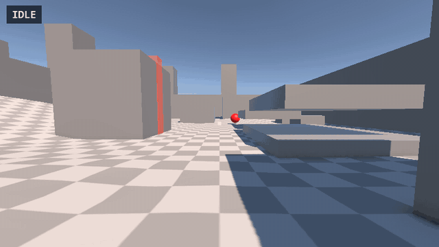
  <br><sub>Demo.unity rendered in Unity 6 by driving the rig with the package's own camera clips and prefab values (scripted playback, not a live capture).</sub>
</p>

---

## Features

<p align="center">
  
</p>

| | Module | What it does | Prefab defaults |
|---|---|---|---|
| 🏃 | `MovementModule` | WASD movement relative to the camera, Shift to sprint, half speed while crouched. Optional smoothing and forward-only "realistic run" | walk 3 · sprint 7 m/s |
| 🖱️ | `LookModule` | Mouse look: yaw on the body, pitch on `CameraPivot` | sensitivity 2 · clamp ±80° |
| 🦘 | `GravityJumpModule` | Raycast ground check, gravity, jumping (lower when crouched), landing sound and camera shake | jump 1.5 m · gravity −25 |
| 🧎 | `CrouchModule` | Hold Ctrl to lerp the capsule and camera down; a ray stops you standing up under ceilings | height 2 → 1 m · camera 1.8 → 0.7 m |
| 🛝 | `SlidingModule` | C while sprinting on the ground: a timed slide in the facing direction, crouched | 6 m/s · 0.7 s |
| ↔️ | `LeaningModule` | Q / E rolls `LeanPivot`, which sits low in the rig so the head swings sideways | ±15° · speed 5 |
| 🪜 | `ClimbLadderModule` | A forward ray finds ladders on the climbable layer; W / S then move you vertically with gravity off | layer 7 · 1 m · 4 m/s |
| 📦 | `PushModule` | Pushes rigidbodies you walk into | impulse 3 |
| 👣 | `FootStepSoundsModule` | Step cadence for walk, sprint and crouch, plus jump, land and slide clips | 0.45 / 0.3 / 0.9 s |
| 🎥 | `CameraAnimationModule` | Drives the camera Animator's `moveState` to blend Idle, Walk, Run and CrouchWalk clips | transition 5 |
| 🌀 | `MovementFxModule` | Tilts `MovementFX` from input and vertical velocity | amount 2 · smooth 6 |
| 💥 | `Shaker` add-on | Fade-in/out position and rotation shake driven by `ShakePreset` assets | land: 0.2 s |
| 💬 | `viewPoint` add-on | World-anchored UI hints that fade in by distance ("Ladder", "Crouch", …) | 6 m / 3 m |

## Controls

<p align="center">
  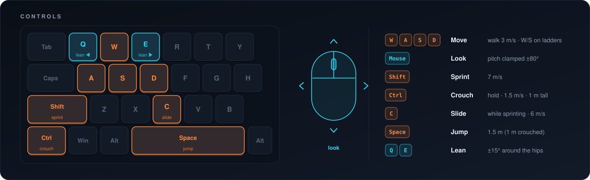
</p>

## Demo scene

`Assets/AdvancedFirstPersonSystems/Demo/Scene/Demo.unity` is a gray-box course with two ladders, a crouch tunnel, jump platforms, a pushable ball and `viewPoint` hints at each spot.

<table>
  <tr>
    <td width="50%">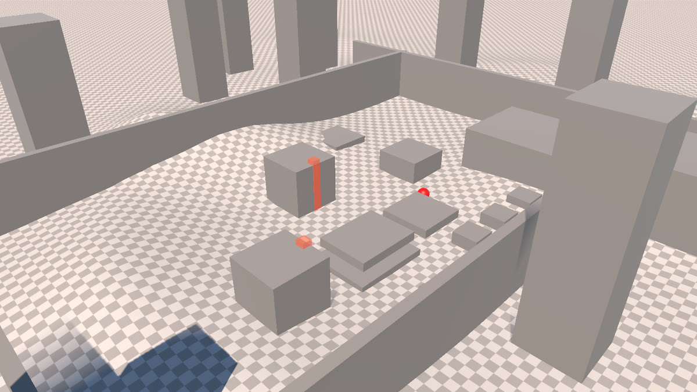</td>
    <td width="50%">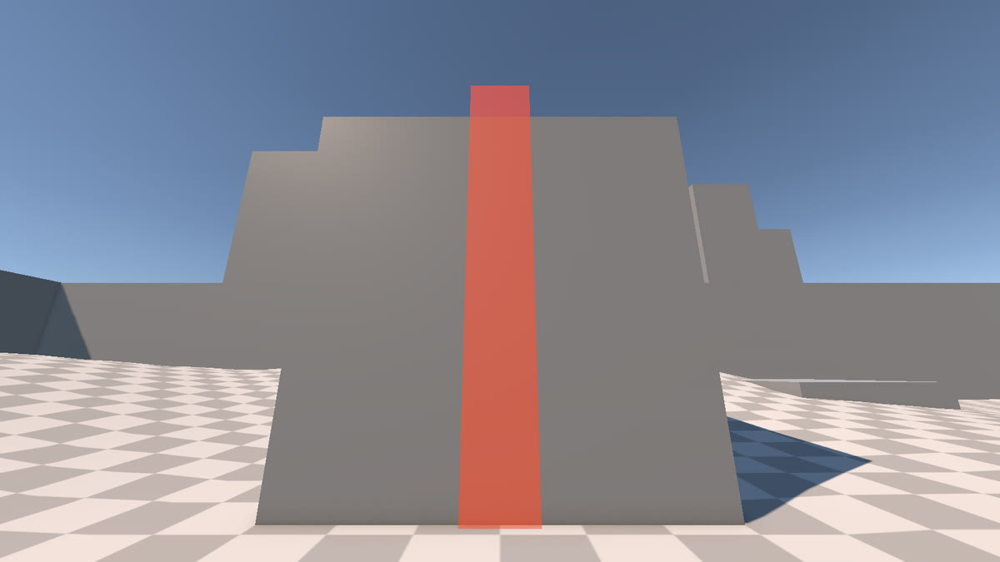</td>
  </tr>
  <tr>
    <td width="50%">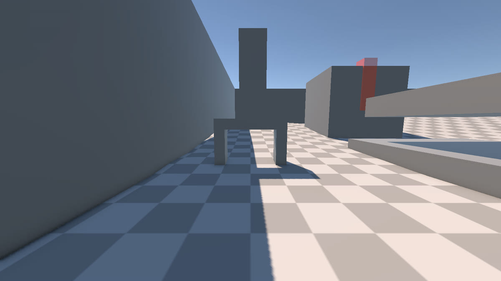</td>
    <td width="50%">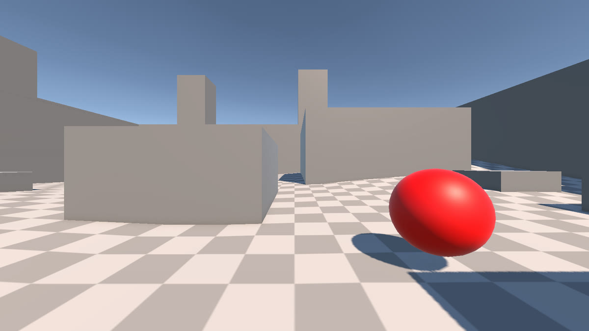</td>
  </tr>
</table>

<sub>Screenshots rendered from the scene in Unity 6000.3 (URP), before Play mode.</sub>

## How it works

### One component, eleven modules

Every module is a plain `[System.Serializable]` class with an `isActive` flag, an `Init(AdvancedFirstPerson)` call and a `Handle…()` method. `AdvancedFirstPerson` initialises them in `Start`, runs them in a fixed order in `Update`, does mouse look in `LateUpdate` and hands collisions to the push module. The camera rig splits the work across nested transforms, so each effect stays independent.

<p align="center">
  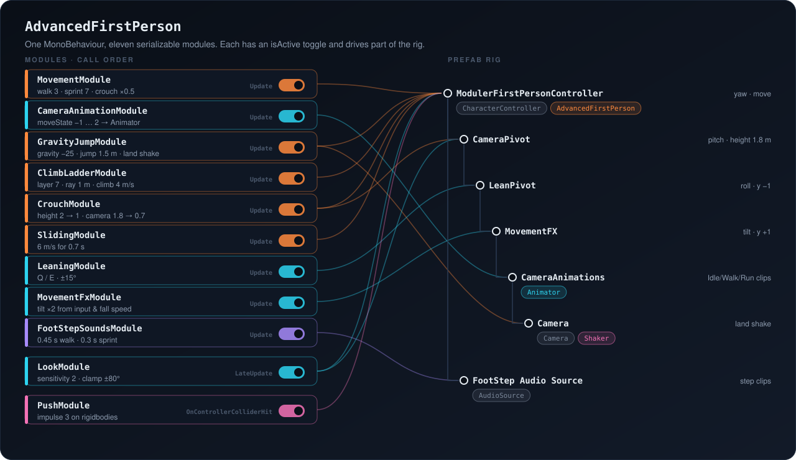
</p>

### Movement states

<p align="center">
  
</p>

### Camera animation

Head bob comes from four small Animation clips on `CameraAnimations`, blended by a 1D blend tree on `moveState` (−1 CrouchWalk, 0 Idle, 1 Walk, 2 Run). `CameraAnimationModule` moves `moveState` toward the current state at `transitionSpeed`, so changes between walking, running and crouching blend smoothly.

<p align="center">
  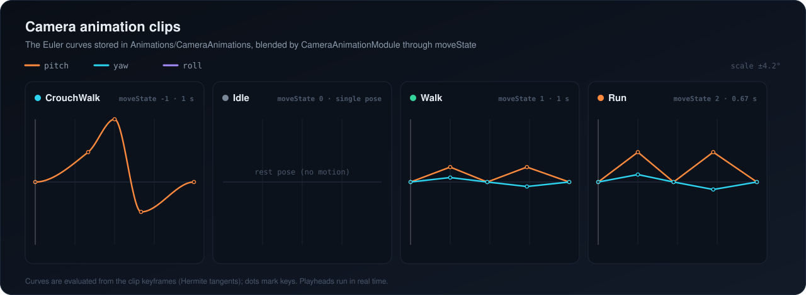
</p>

## Getting started

### Requirements

| | |
|---|---|
| **Unity** | 2022.3 LTS or Unity 6 (checked on 6000.3) |
| **Render pipeline** | URP. The demo materials use URP Lit; the controller code itself is pipeline-agnostic |
| **Input** | Uses the legacy `Input` class. Set *Project Settings → Player → Active Input Handling* to **Input Manager (Old)** or **Both** |
| **TextMesh Pro** | `viewPoint` labels use TMP. Import *TMP Essential Resources* when Unity asks (or via *Window → TextMeshPro*) |

### Install

**Option A — .unitypackage (recommended)**

1. Download `AFP-*.unitypackage` from the [latest release](https://github.com/BerTaDev/Unity-FPS-Controller/releases/latest).
2. In Unity: *Assets → Import Package → Custom Package…* and import everything.
3. Open `Assets/AdvancedFirstPersonSystems/Demo/Scene/Demo.unity` and press **Play**.

**Option B — copy the source**

```bash
git clone https://github.com/BerTaDev/Unity-FPS-Controller.git
```

Copy the repository's `Assets/` folder into your project, keeping the `.meta` files so prefab and scene references stay intact.

### Use it in your own scene

1. Drag **`Prefabs/ModulerFirstPersonController.prefab`** into the scene and remove the default *Main Camera* (the prefab brings its own).
2. Put walkable geometry on a layer included in **Gravity Jump Module → Ground Layer** (Default by default).
3. **Ladders:** drop in `Prefabs/LadderTrigger.prefab` (or any collider) on layer **7** and stretch it along the ladder. Naming layer 7 "Ladder" in *Tags & Layers* is optional but helps.
4. **Hints (optional):** add a Screen Space canvas, then place `ViewPointWorldPrefab` objects and set their text. They look for the object tagged `Player`, which the prefab already is.
5. Turn modules on or off with their `isActive` checkbox on the `AdvancedFirstPerson` component.

### Footstep audio

The sound effects are **not included** because they come from a third-party pack whose licence does not allow redistribution:

1. Add the free **[Footsteps – Essentials](https://assetstore.unity.com/packages/audio/sound-fx/foley/footsteps-essentials-189879)** pack by Nox_Sound to your project.
2. On *Foot Step Sounds Module*, assign `Footsteps_Tile_Walk_01…08` to **Walk Footsteps**, `Footsteps_Tile_Jump_Start_01…03` to **Jump Footsteps**, `Footsteps_Tile_Jump_Land_01…03` to **Land Footsteps**, and any slide sound to **Slide Sound Effect**.

The prefab still refers to the original clips by GUID, so if the imported pack keeps those GUIDs the slots fill in on their own. Without clips everything else works; the module skips missing sounds.

> The demo scene's *Global Volume* points to a volume profile that was not part of the original package, so it shows as missing. Assign any profile, or leave it empty.

## Inspector reference

Values are the ones saved in `ModulerFirstPersonController.prefab`.

<details>
<summary><b>AdvancedFirstPerson</b> — references and debug</summary>

| Field | Description |
|---|---|
| `drawGizmos` | Draws the capsule, lean point, move-FX point and footstep source in the Scene view with labels |
| `ActiveCursor` | Leave off to lock and hide the cursor in Play mode |
| `cameraAnimator` | Animator on `CameraAnimations` |
| `leanTransform` / `cameraTransform` / `movementFxTransform` | `LeanPivot` / `CameraPivot` / `MovementFX` |
| `CameraShaker` | `Shaker` on the camera, used for the landing shake |
| `characterController` | The `CharacterController` on the root |

</details>

<details>
<summary><b>Movement · Look · Gravity & Jump</b></summary>

| Module | Field | Default | Description |
|---|---|---|---|
| Movement | `walkSpeed` / `sprintSpeed` | 3 / 7 | m/s; crouching uses half of `walkSpeed` |
| | `enableSmoothing` / `smoothValue` | off / 5 | Ease speed and direction changes |
| | `enableRealisticRun` | off | Only sprint while moving forward |
| Look | `sensitivity` | 2 | Mouse multiplier |
| | `xClamp` | 80 | Pitch limit (°) |
| Gravity & Jump | `groundCheckDistance` / `groundLayer` | 0.5 / Default | Downward ray from the feet |
| | `gravity` / `jumpHeight` | −25 / 1.5 | Jump is `jumpHeight / 1.5` when crouched |
| | `enableLandShake` / `landShakePreset` | on / LandShakePreset | Shake on landing |

</details>

<details>
<summary><b>Crouch · Sliding · Leaning · Ladder</b></summary>

| Module | Field | Default | Description |
|---|---|---|---|
| Crouch | `crouchHeight` / `normalHeight` | 1 / 2 | Capsule height (m) |
| | `crouchCameraHeight` | 0.7 | `CameraPivot` height while crouched (standing is 1.8) |
| | `transitionSpeed` | 5 | Lerp speed |
| Sliding | `slideSpeed` / `slideDuration` | 6 / 0.7 | m/s and seconds |
| Leaning | `leanAngle` / `leanSpeed` | 15 / 5 | Degrees and lerp speed |
| Climb Ladder | `climbSpeed` | 4 | m/s |
| | `climbableLayers` / `stairDetectionDistance` | layer 7 / 1 | Forward ray from mid-height |

</details>

<details>
<summary><b>Camera animation · Movement FX · Footsteps · Push · Shaker</b></summary>

| Module | Field | Default | Description |
|---|---|---|---|
| Camera Animation | `transitionSpeed` | 5 | How fast `moveState` moves toward the target |
| Movement FX | `rotationAmount` / `rotationSmooth` | 2 / 6 | Tilt from WASD input |
| | `movementAmount` | 2 | Extra pitch from vertical velocity |
| Foot Step Sounds | `walkStepInterval` / `sprintStepInterval` | 0.45 / 0.3 | Seconds between steps (crouch uses 2× walk) |
| Push | `pushStrength` | 3 | Impulse applied to rigidbodies |
| `LandShakePreset` | `rotationStrength` / `Strength` | (1, 1, 1) / 0.4 | Rotation-only shake |
| | `Duration` / `FadeOutDuration` / `Frequency` | 0.2 / 0.15 / 1 | Create more presets via *Create → BerTaDEV → Shaker → Shake Preset* |

</details>

## Writing your own module

Modules follow one small pattern, so adding a new ability is mostly copy and paste:

```csharp
namespace BerTaDEV
{
    [System.Serializable]
    public class DashModule
    {
        public bool isActive;
        public float dashSpeed = 15f;

        private AdvancedFirstPerson AFP;
        public void Init(AdvancedFirstPerson afp) => AFP = afp;

        public void HandleDash()
        {
            if (!isActive) return;
            if (Input.GetKey(KeyCode.F))
                AFP.characterController.Move(AFP.transform.forward * dashSpeed * Time.deltaTime);
        }
    }
}
```

Add a `public DashModule dashModule;` field to `AdvancedFirstPerson`, call `dashModule.Init(this)` in `Start` and `dashModule.HandleDash()` in `Update`.

## Project structure

```text
Assets/
├── AdvancedFirstPersonSystems/
│   ├── Prefabs/
│   │   ├── ModulerFirstPersonController.prefab   ← drop this into your scene
│   │   ├── LadderTrigger.prefab
│   │   └── ViewPointWorldPrefab.prefab · ViewPointCanvasPrefab.prefab
│   ├── Scripts/
│   │   ├── Controller/
│   │   │   ├── AdvancedFirstPerson.cs              the component that runs the modules
│   │   │   └── MovementModule.cs · LookModule.cs · GravityJumpModule.cs · CrouchModule.cs
│   │   │       SlidingModule.cs · LeaningModule.cs · ClimbLadderModule.cs · PushModule.cs
│   │   │       FootStepSoundsModule.cs · CameraAnimationModule.cs · MovementFxModule.cs
│   │   └── Addons/
│   │       ├── Shaker/  Shaker.cs · ShakePreset.cs
│   │       └── viewPoint.cs
│   ├── Animations/CameraAnimations/   Idle · Walk · Run · CrouchWalk + Animator controller
│   ├── Presets/LandShakePreset.asset
│   └── Demo/                          Demo.unity, terrain, lighting, materials
├── Editor/ReadOnlyInspectorDrawer.cs   greys out [ReadOnlyInspector] fields
└── content_game/Scripts/utilities/ReadOnlyInspectorAttribute.cs
```

`ReadOnlyInspector` comes from BerTaDEV's ReadOnlyInspector helper and is included so the package compiles on its own. All scripts use the `BerTaDEV` namespace.

## License

The code in this repository is released under the [MIT License](LICENSE). Third-party audio is not included; see [Footstep audio](#footstep-audio).

<p align="center"><sub>Made by <b>BerTaDEV</b> · <a href="https://www.bertadev.com">bertadev.com</a></sub></p>
